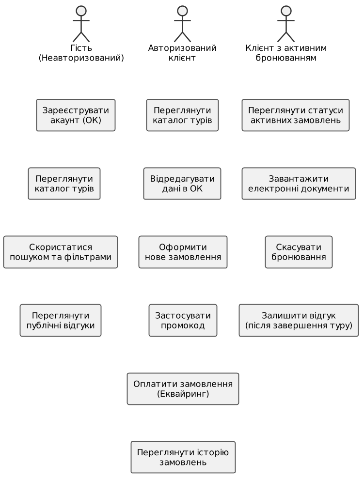
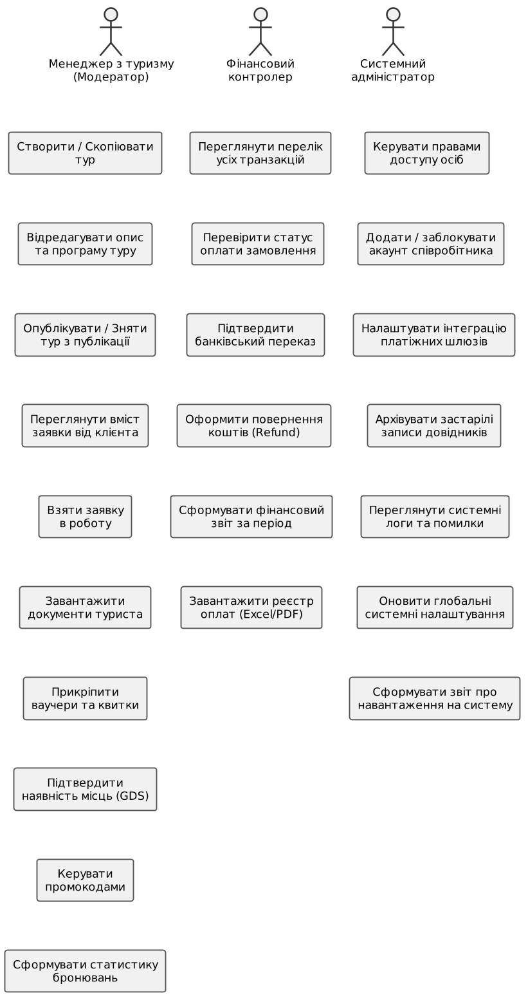
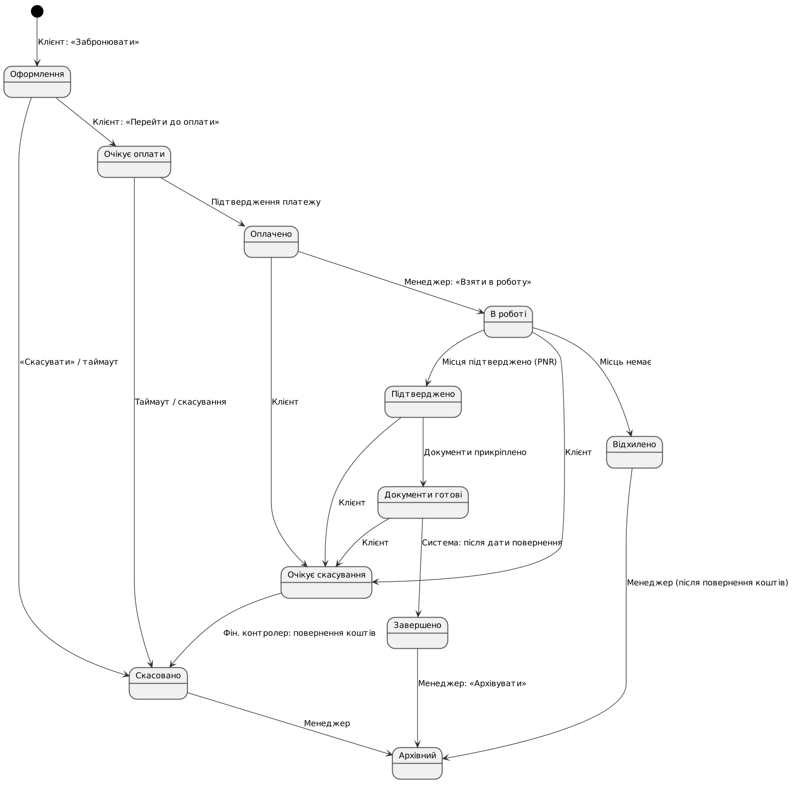

**1. ПЕРЕЛІК УМОВНИХ СКОРОЧЕНЬ ТА ТЕРМІНІВ 3**

**2. ЗАГАЛЬНІ ВІДОМОСТІ 6**

> 2.1. Призначення документа 6
>
> 2.2. Загальні положення 6
>
> 2.3. Повне найменування системи та її умовне позначення 7
>
> 2.4. Найменування замовника, реципієнта та виконавця 7
>
> 2.5. Планові терміни початку та закінчення робіт 8
>
> 2.6. Нормативно-правові документи, використані під час створення системи 9
>
> 2.7. Обсяг першого релізу (MVP) 10

**3. ПРИЗНАЧЕННЯ ТА ЦІЛІ СТВОРЕННЯ СИСТЕМИ 11**

> 3.1. Мета створення системи 11
>
> 3.2. Призначення системи 13
>
> 3.3. Характеристики об'єкта автоматизації 14

**4. ВИМОГИ ДО СИСТЕМИ 15**

> 4.1. Вимоги до Системи в цілому 15
>
> 4.2. Вимоги до структури та функціонування 16
>
> 4.3. Групи та кабінети користувачів в Системі 17
>
> 4.4. Загальний опис процесу 22
>
> 4.4.1. Модель статусів 24
>
> 4.5. Опис процесів (сценарії використання Системи) 27
>
> 4.5.1. Користувач — Реєстрація 27
>
> 4.5.1.1. Користувач — Зміна особистих даних 28
>
> 4.5.2. Менеджер — Створення туристичного продукту (туру) 29
>
> 4.5.3. Клієнт — Подача заявки на бронювання туру (Чекаут) 30
>
> 4.5.4. Менеджер — Технічний аналіз заявки 31
>
> 4.5.5. Клієнт — Скасування бронювання та запит на повернення коштів 32
>
> 4.5.6. Фінансовий контролер — Фінансова верифікація транзакції та повернення коштів 32
>
> 4.5.7. Клієнт — Залишення відгуку про туристичний продукт 33
>
> 4.5.8. Системний адміністратор — Управління глобальними налаштуваннями та довідниками 34
>
> 4.5.9. Менеджер — Завершення етапу бронювання та архівація 35
>
> 4.6. Форми заяв 35
>
> 4.6.1. Актор — Клієнт (Користувач) 35
>
> 4.6.2. Актор — Менеджер 41
>
> 4.6.3. Актор — Фінансовий контролер 45
>
> 4.6.4. Актор — Системний адміністратор 46

**5. НЕФУНКЦІОНАЛЬНІ ВИМОГИ 47**

> 5.1. Вимоги до надійності та відмовостійкості 47
>
> 5.2. Вимоги до потужності системи 49
>
> 5.3. Вимоги до інтерфейсу користувача 50
>
> 5.4. Вимоги до захисту інформації від несанкціонованого доступу 51
>
> 5.5. Вимоги до інформаційної безпеки 52
>
> 5.6. Вимоги до патентної чистоти 52
>
> 5.7. Вимоги до розвитку та модернізації системи 53
>
> 5.8. Вимоги до стандартизації та уніфікації 54
>
> 5.9. Вимоги до інформаційного забезпечення 54

**6. АДМІНІСТРАТИВНА ІНФРАСТРУКТУРА 55**

> 6.1. Розміщення системи 55
>
> 6.2. Система резервного копіювання та відновлення після аварій 56
>
> 6.3. Логування 57
>
> 6.4. Підключення до системи моніторингу та алертингу 58

**7. ТЕХНОЛОГІЧНИЙ СТЕК 59**

**8. ПОРЯДОК КОНТРОЛЮ ТА ПРИЙМАННЯ СИСТЕМИ 60**

> 8.1. Приймальні випробування 61

**1. ПЕРЕЛІК УМОВНИХ СКОРОЧЕНЬ ТА ТЕРМІНІВ**

| **Термін**                                                 | **Значення та детальне роз'яснення**                                                                                                                                                                                                                                                                                                                                                                                                                     |
|------------------------------------------------------------|----------------------------------------------------------------------------------------------------------------------------------------------------------------------------------------------------------------------------------------------------------------------------------------------------------------------------------------------------------------------------------------------------------------------------------------------------------|
| **СПІВРОБІТНИК (ПОСАДОВА ОСОБА)**                          | Узагальнена назва для ролей Менеджера, Фінансового контролера та Системного адміністратора. Кожен співробітник має доступ до панелі управління (Back-office) лише в межах прав, визначених його роллю (розділ 4.3).                                                                                                                                                                                                                                      |
| **МЕНЕДЖЕР (МОДЕРАТОР)**                                   | Уповноважений співробітник туристичної компанії, який відповідає за наповнення каталогу турів, управління промокодами, технічний аналіз та обробку заявок клієнтів (перевірка наявності місць, введення PNR, завантаження електронних документів), модерування відгуків та архівування замовлень.                                                                                                                                                        |
| **ФІНАНСОВИЙ КОНТРОЛЕР**                                   | Уповноважений співробітник фінансового відділу, який перевіряє надходження коштів, підтверджує ручні банківські перекази, оформлює повернення коштів (Refund) та формує фінансові звіти.                                                                                                                                                                                                                                                                 |
| **СИСТЕМНИЙ АДМІНІСТРАТОР**                                | Уповноважений технічний співробітник, який керує обліковими записами співробітників та їх ролями, веде системні довідники та глобальні налаштування (курси валют, таймаут бронювання, режим технічних робіт) і має доступ до логів Системи. Не виконує обробку замовлень та фінансових операцій (принцип розподілу прав, розділ 7).                                                                                                                      |
| **КЛІЄНТ (КОРИСТУВАЧ)**                                    | Будь-яка фізична особа, яка досягла повноліття, або уповноважений представник юридичної особи (наприклад, для організації корпоративних турів), що використовує публічні засоби Системи для здійснення пошуку, вибору, порівняння, бронювання та подальшої оплати туристичних послуг згідно з умовами публічної оферти.                                                                                                                                  |
| **ОК (ОСОБИСТИЙ КАБІНЕТ)**                                 | Персоналізована та захищена вебсторінка (графічний інтерфейс), доступ до якої надається Клієнту після проходження процедури автентифікації та авторизації. Через ОК користувачі мають можливість зберігати історію бронювань, керувати контактними даними та документами (паспортні дані пасажирів), відстежувати статуси замовлень у реальному часі, отримувати електронні документи (ваучери, квитки, страховки) та спілкуватися зі службою підтримки. |
| **ПЗ**                                                     | Програмне забезпечення — сукупність програмних кодів, скриптів, баз даних та архітектурних рішень, що забезпечують функціонування вебсайту.                                                                                                                                                                                                                                                                                                              |
| **СИСТЕМА (ВЕБСАЙТ)**                                      | Комплексне програмне забезпечення для електронної комерції у сфері туризму, що становить собою єдиний цифровий простір. Система дозволяє в автоматичному та напівавтоматичному режимах здійснювати підбір, бронювання турів, продаж супутніх туристичних послуг (страхування, трансфери, екскурсії) в електронній формі, інтегруючи внутрішні процеси компанії із зовнішніми постачальниками послуг.                                                     |
| **ТУР**                                                    | Попередньо розроблений та сформований комплекс туристичних послуг, що пропонується для бронювання та придбання через Систему. Тур зазвичай включає (але не обмежується): послуги з розміщення (готель), харчування, транспортне обслуговування (авіапереліт, автобус, трансфер), екскурсійне обслуговування та базове медичне страхування.                                                                                                               |
| **API (Application Programming Interface)**                | Набір стандартизованих інструментів, протоколів та інструкцій, що дозволяє компонентам Системи взаємодіяти із зовнішніми сервісами в режимі реального часу. Включає інтеграцію з платіжними шлюзами, глобальними системами дистрибуції (GDS), базами даних туроператорів-партнерів, CRM-системами та ERP-системами компанії.                                                                                                                             |
| **CRM (Customer Relationship Management)**                 | Система управління відносинами з клієнтами (може бути як внутрішнім модулем Системи, так і зовнішнім інтегрованим програмним забезпеченням), призначена для автоматизації стратегій взаємодії із замовниками, збереження історії спілкування, аналізу клієнтської бази та підвищення рівня продажів.                                                                                                                                                     |
| **GDS (Global Distribution System)**                       | Глобальна комп'ютерна мережа бронювання, яка використовується як єдина точка доступу для резервування авіаквитків, готельних номерів, прокату автомобілів та інших туристичних послуг по всьому світу.                                                                                                                                                                                                                                                   |
| **OTA (Online Travel Agency)**                             | Туристичне агентство, що реалізує туристичні продукти та послуги виключно або переважно через мережу Інтернет (онлайн-платформу), яким і є створювана Система.                                                                                                                                                                                                                                                                                           |
| **ВАУЧЕР (ЕЛЕКТРОННИЙ ВАУЧЕР)**                            | Цифровий документ, що автоматично генерується Системою після повної оплати туру та підтвердження всіх послуг постачальниками. Є офіційним підтвердженням права Клієнта на отримання туристичних послуг (проживання, харчування, трансфер), зазначених у ньому.                                                                                                                                                                                           |
| **ЧАРТЕР (ЧАРТЕРНИЙ РЕЙС)**                                | Нерегулярний авіарейс, який замовляється туроператором спеціально для перевезення своїх туристів за певним маршрутом у визначений сезон. Інформація про чартерні рейси синхронізується в Системі окремо від регулярних рейсів.                                                                                                                                                                                                                           |
| **ПРОМОКОД (DISCOUNT CODE)**                               | Унікальний буквено-цифровий ідентифікатор, який створюється Менеджером (форма 4.6.2.3) у рамках маркетингових кампаній. Клієнт може застосувати його на етапі оформлення замовлення (чекауту) для отримання автоматичної знижки у відсотковому або фіксованому еквіваленті.                                                                                                                                                                              |
| **СЕСІЯ КОРИСТУВАЧА (SESSION)**                            | Період часу, протягом якого Клієнт активно взаємодіє із Системою. Дані сесії (наприклад, тимчасово збережені фільтри пошуку або товари в кошику) зберігаються на сервері або в локальному сховищі браузера для забезпечення безперервності користувацького досвіду.                                                                                                                                                                                      |
| **БЕКЕНД (BACKEND)**                                       | Програмно-апаратна частина Системи, прихована від кінцевого користувача. Відповідає за реалізацію бізнес-логіки, обробку запитів, взаємодію з базами даних, проведення математичних розрахунків вартості та обмін даними через API.                                                                                                                                                                                                                      |
| **ФРОНТЕНД (FRONTEND)**                                    | Клієнтська частина Системи (інтерфейс), з якою безпосередньо взаємодіє користувач у своєму браузері. Відповідає за візуальне відображення контенту, адаптивність дизайну та обробку базових користувацьких подій (кліки, введення тексту).                                                                                                                                                                                                               |
| **СЕРВЕР (SERVER / CLOUD)**                                | Виділені фізичні або хмарні обчислювальні потужності, на яких розгортається і функціонує Система, включаючи сервери баз даних, сервери застосунків та системи резервного копіювання.                                                                                                                                                                                                                                                                     |
| **GDPR (General Data Protection Regulation)**              | Загальний регламент про захист даних — обов'язковий регламент ЄС, норми якого імплементуються в Систему для забезпечення найвищого рівня конфіденційності, захисту, обробки та зберігання персональних даних користувачів.                                                                                                                                                                                                                               |
| **PCI DSS (Payment Card Industry Data Security Standard)** | Міжнародний стандарт безпеки даних індустрії платіжних карток, розроблений міжнародними платіжними системами. Вимоги стандарту є обов'язковими для реалізації в модулі онлайн-оплати Системи задля запобігання шахрайству та витоку даних карток.                                                                                                                                                                                                        |
| **СКБД (DBMS)**                                            | Система керування базами даних — спеціалізоване програмне забезпечення, призначене для створення, наповнення, оновлення, видалення та пошуку даних у базах даних Системи (наприклад, інформації про користувачів, тури, транзакції).                                                                                                                                                                                                                     |
| **БАГ (BUG)**                                              | Програмна помилка, дефект або збій у вихідному коді Системи, що призводить до неочікуваної або неправильної поведінки програми, і підлягає обов'язковому усуненню на етапах тестування та гарантійної підтримки.                                                                                                                                                                                                                                         |
| **БД (БАЗА ДАНИХ)**                                        | Централізована реляційна база даних Системи, керована СКБД, у якій зберігаються дані про користувачів, тури, замовлення, транзакції, відгуки та довідники.                                                                                                                                                                                                                                                                                               |
| **КВОТА (ЖОРСТКИЙ БЛОК МІСЦЬ)**                            | Кількість гарантованих місць за туром (на рейсі та в готелі), доступних для продажу через Систему. Під час оформлення замовлення місця тимчасово утримуються на час таймауту бронювання, після оплати — списуються з квоти, а при скасуванні чи відхиленні замовлення — повертаються до неї (розділ 4.4.1).                                                                                                                                              |
| **PNR (Passenger Name Record)**                            | Унікальний код бронювання в глобальній системі дистрибуції (GDS), що підтверджує резервування місць для туристів. Вноситься Менеджером під час технічного аналізу заявки (форма 4.6.2.2).                                                                                                                                                                                                                                                                |
| **ФПВ (ФАКТИЧНО ПОНЕСЕНІ ВИТРАТИ)**                        | Сума витрат, яку туроператор або постачальники послуг уже понесли за замовленням на момент його скасування (штрафи готелів, авіакомпаній тощо). Утримується із суми, що повертається Клієнту при скасуванні бронювання з його ініціативи.                                                                                                                                                                                                                |
| **MVP (Minimum Viable Product)**                           | Перший реліз Системи з мінімально необхідним набором функцій для проходження повного бізнес-процесу бронювання всіма ролями користувачів. Обсяг MVP визначено в розділі 2.7.                                                                                                                                                                                                                                                                             |

## 2. ЗАГАЛЬНІ ВІДОМОСТІ

### **2.1. Призначення документа**

Цей документ розроблений відповідно до міжнародних та національних стандартів інженерії програмного забезпечення і має на меті надати максимально деталізований, вичерпний опис функціональних, технічних, архітектурних та якісних вимог для реалізації масштабного проєкту з розробки програмного забезпечення електронної комерції — вебсайту туристичної компанії.

### **2.2. Загальні положення**

Сучасний туристичний ринок переживає епоху глибокої цифрової трансформації. Класична модель туристичних агентств, що базується на особистих візитах клієнтів до офісів та ручному оформленні документів, стрімко втрачає актуальність. Споживачі вимагають миттєвого доступу до інформації, прозорого ціноутворення та можливості самостійно планувати свої подорожі у будь-який час та з будь-якого пристрою. У цьому контексті розробка та впровадження високотехнологічної Системи є стратегічним кроком Замовника для утримання лідерських позицій на ринку, розширення цільової аудиторії та оптимізації внутрішніх операційних витрат.

У цьому документі визначені технічні характеристики та вичерпний перелік послуг щодо розробки та впровадження Системи, яка об'єднає розрізнені бізнес-процеси (консультації, підбір турів, перевірку квот, виписку документів, фінансовий облік) у єдину, автоматизовану екосистему.

Для забезпечення ефективного функціонування та досягнення бізнес-показників, розроблювана Система повинна беззаперечно відповідати наступним фундаментальним вимогам:

- хмарна орієнтованість та кросплатформність;

- функціональна повнота (End-to-End) процес;

- висока надійність та відмовостійкість;

- модульність та абсолютна масштабованість;

- ергономіка та інклюзивність інтерфейсу (UI/UX);

- безпрецедентний рівень інформаційної безпеки.

### **2.3. Повне найменування системи та її умовне позначення**

Повне офіційне найменування: Програмне забезпечення для багатоканальної електронної комерції та автоматизації бізнес-процесів «Вебсайт бронювання туристичних послуг».

Умовні позначення в технічній документації: Система, Вебсайт, ПЗ, Платформа.

### **2.4. Найменування замовника, реципієнта та виконавця**

Замовник послуг: Товариство з обмеженою відповідальністю «Глобал Тревел Україна» (далі — Замовник).

Реципієнт: Товариство з обмеженою відповідальністю «TravelUkr» (далі — Реципієнт) — туристичний оператор, на інфраструктурі якого розгортається продуктивне середовище (PROD) і який є кінцевим експлуатантом (отримувачем) Системи.

Виконавець: Товариство з обмеженою відповідальністю «DMSoft» (далі — Виконавець).

### **2.5. Планові терміни початку та закінчення робіт**

Розробка Системи є комплексним інженерним проєктом, що вимагає суворого дотримання календарного плану-графіка робіт. Процес поділено на логічні спринти (етапи) з метою забезпечення прозорого контролю з боку Замовника.

Плановий термін початку робіт: 06.11.2026 року (момент узгодження цього Технічного завдання).

Орієнтовний термін завершення робіт: 25.11.2026 року.

> Життєвий цикл розробки поділяється на наступні ключові фази, кожна з яких завершується підписанням проміжного акту виконаних робіт:

1)  фаза аналізу та проєктування (06.11–10.11.2026) – уточнення Технічного завдання, розробка моделі статусів, ER-діаграми бази даних та специфікації REST API, створення каркасу проєкту та середовища розробки (Docker);

2)  фаза розробки Бекенду (10.11–14.11.2026) – реалізація автентифікації та рольової моделі, каталогу турів, оформлення та обробки замовлень, REST API;

3)  фаза розробки Фронтенду (14.11–19.11.2026) – верстка та програмування публічного каталогу, Особистого кабінету, чекауту та панелі управління (Back-office) для співробітників;

4)  фаза завершення функціоналу та внутрішнього тестування (19.11–22.11.2026) – скасування бронювань і повернення коштів, відгуки, системні налаштування, логування, функціональне тестування та виправлення дефектів (багів);

5)  фаза приймальних випробувань (22.11–25.11.2026) – наповнення Системи тестовими даними, підготовка інструкцій, програми та методики випробувань, демонстрація готового продукту Замовнику.

### **2.6. Нормативно-правові документи, використані під час створення системи**

Оскільки Система оперує фінансовими потоками, персональними даними громадян та здійснює комерційну діяльність у мережі Інтернет, її архітектура, алгоритми збору згоди користувачів та механізми зберігання інформації базуються на суворому дотриманні чинного законодавства України та міжнародних правових норм. Нижче наведено перелік основних нормативно-правових актів та стандартів, що регламентують створення та функціонування Системи:

- Конституція України;

- Закон України «Про туризм»;

- Закон України «Про електронну комерцію»;

- Закон України «Про електронні довірчі послуги»;

- Закон України «Про захист персональних даних»;

- Закон України «Про захист прав споживачів»;

- Закон України «Про захист інформації в інформаційно-комунікаційних системах»;

- GDPR (General Data Protection Regulation) — Міжнародний регламент ЄС, обов'язковий до виконання, оскільки послугами Системи можуть користуватися громадяни Європейського Союзу, або ж туристичні продукти реалізуються на території ЄС;

- PCI DSS (Payment Card Industry Data Security Standard) — Міжнародний стандарт безпеки платіжних карток. Хоча сама Система безпосередньо не зберігатиме номери кредитних карток (CVC-коди), передаючи цю функцію сертифікованому платіжному шлюзу (наприклад, LiqPay або Stripe), загальна архітектура чекауту повинна відповідати вимогам цього стандарту, щоб гарантувати відсутність вразливостей, через які зловмисники могли б перехопити платіжний трафік.

Даний перелік не є вичерпним. Вимоги законодавства України, нормативних та керівних документів, що стосуються мети, призначення та цілей надання послуг можуть бути уточнені.

### **2.7. Обсяг першого релізу (MVP)**

Відповідно до планових термінів (розділ 2.5) перший реліз Системи реалізується як MVP (Minimum Viable Product) — версія, що забезпечує проходження повного бізнес-процесу бронювання (розділ 4.4) усіма ролями користувачів. Нижче визначено, які вимоги цього Технічного завдання реалізуються в повному обсязі, які — у спрощеному вигляді, а які переносяться на наступні етапи розвитку Системи (розділ 5.7).

У повному обсязі в MVP реалізуються:

- реєстрація, автентифікація та рольова модель користувачів (Гість, Клієнт, Менеджер, Фінансовий контролер, Системний адміністратор);

- каталог турів із пошуком, фільтрацією та сортуванням;

- створення, публікація та архівування турів Менеджером, управління промокодами;

- оформлення замовлення (чекаут) з розрахунком вартості та тимчасовим утриманням квоти місць;

- обробка замовлень Менеджером згідно з моделлю статусів (розділ 4.4.1) та завантаження електронних документів;

- скасування бронювання Клієнтом, фінансова верифікація та оформлення повернення коштів Фінансовим контролером;

- відгуки та рейтинг турів;

- управління користувачами, довідниками та глобальними налаштуваннями Системним адміністратором.

У спрощеному вигляді реалізуються:

- інтеграція з GDS — наявність місць перевіряється Менеджером поза Системою, номер бронювання (PNR) вводиться вручну;

- онлайн-оплата — через тестовий режим платіжного шлюзу або програмну імітацію (mock) підтвердження платежу;

- сповіщення — відображаються в Особистому кабінеті та фіксуються в журналі Системи без фактичного надсилання E-mail/SMS;

- логування — структуровані логи у форматі JSON (розділ 6.3) без підключення до зовнішньої системи моніторингу;

- резервне копіювання — скрипт формування дампу бази даних;

- розгортання — одне середовище (DEV) на основі Docker Compose.

До MVP не входять (переносяться на наступні етапи, розділ 5.7):

- програма лояльності, функції «Обране» та «Історія пошуку»;

- зміна параметрів підтвердженого туру Клієнтом та онлайн-чат зі службою підтримки;

- англомовна версія інтерфейсу;

- середовища STAGE та PROD, система моніторингу та алертингу (розділ 6.4);

- шифрування даних у базі даних та резервних копій (розділ 7).

**3. ПРИЗНАЧЕННЯ ТА ЦІЛІ СТВОРЕННЯ СИСТЕМИ**

**3.1. Мета створення системи**

Фундаментальною метою реалізації Системи є створення безперервної цифрової екосистеми, яка технологічно об'єднує клієнтів туристичної компанії, зовнішніх постачальників послуг та внутрішній менеджмент у рамках єдиного високотехнологічного простору. Головним завданням цього процесу є глибока революціонізація традиційного формату замовлення туристичних продуктів шляхом надання інтегрованої платформи, що ефективно усуває поточні операційні неефективності у наданні сервісу. Система покликана забезпечити максимальну ефективність та прозорість роботи компанії у частині виконання її комерційних повноважень, автоматизувати рутинні процедури подання клієнтських заявок, їх опрацювання, фінансової калькуляції та визначення фінального статусу бронювання з подальшим генеруванням електронних проїзних документів. Актуальність розробки цього комплексного вебсервісу безпосередньо обґрунтовується прискореною цифровою трансформацією сфери послуг, яка змушує бізнес переходити на безконтактні формати обслуговування. Сучасні споживачі дедалі більше очікують клієнтського досвіду, орієнтованого на цифрові технології (digital-first), тоді як традиційні системи замовлення послуг телефоном або через фізичні офіси невідворотно стають застарілими та неконкурентоспроможними.

Впровадження електронної форми взаємодії має на меті кардинально знизити операційне навантаження на штатних співробітників, повністю ліквідуючи необхідність ручного введення даних та фізичного підписання паперових угод. Реалізація розробленої Системи відкриє доступ до туристичних продуктів значно більшій кількості клієнтів різних вікових та соціальних категорій, подолавши будь-які географічні та часові бар'єри, а також сприятиме підвищенню загального рівня прозорості проведення транзакцій та рівня довіри до процесу фінансування послуг шляхом впровадження стандартизованих електронних процедур. Економічний вплив та головна бізнес-ціль проєкту полягає в тому, що нова платформа демократизує доступ до високотехнологічного цифрового обслуговування, дозволяючи туристичній компанії надзвичайно ефективно конкурувати на глобальному ринку за рахунок радикального зниження маржинальних витрат на обробку кожної окремої заявки. Крім того, наявність централізованого цифрового ядра дозволить керівництву компанії здійснювати глибинний моніторинг операційної діяльності та прогнозувати попит.

**3.2. Призначення системи**

Головне призначення розроблюваного вебсервісу полягає у наданні користувачам зручної можливості самостійно замовляти комплексні туристичні продукти через єдину цифрову платформу, що повністю усуває необхідність прямих телефонних дзвінків менеджерам для отримання базових консультацій, суттєво зменшує час очікування та забезпечує вичерпний огляд усіх доступних пропозицій у режимі реального часу. Платформа безпосередньо призначена для перегляду розширених каталогів із детальними описами напрямків та фотографіями високої роздільної здатності, розміщення замовлень із надзвичайно широкими можливостями кастомізації послуг та безпечної обробки платежів через кілька інтегрованих методів оплати з використанням найсучасніших протоколів шифрування.

Для зареєстрованих клієнтів Система призначена слугувати повноцінним персональним помічником, який дозволяє детально відстежувати статус замовлення в режимі реального часу від моменту створення заявки до успішного повернення з подорожі, а також ефективно керувати комплексними обліковими записами, що містять повну історію поїздок, збережені електронні документи та специфічні персональні вподобання. Цільова аудиторія, для якої призначена Система, охоплює міських професіоналів та молодь, які мають обмежений час на тривале планування подорожей і шукають надійні та швидкі рішення для економії зусиль, а також сім'ї, що шукають зручні комплексні рішення для відпочинку та стабільно надійний сервіс. Для задоволення їхніх потреб призначення системи включає обов'язкову реалізацію підходу «mobile-first», оскільки понад 70% сучасних користувачів отримують доступ до подібних платформ саме через смартфони. Одночасно вебсервіс призначений для реінжинірингу та глибокої автоматизації внутрішніх процесів бек-офісу, надаючи адміністраторам і власникам компанії надзвичайно потужні інструменти управління замовленнями, ведення структурованої клієнтської бази та формування розширеної бізнес-аналітики.

**3.3. Характеристики об'єкта автоматизації**

Безпосередніми об'єктами автоматизації виступають процеси підбору, багатофакторної калькуляції, бронювання, фінансового супроводу та аналітики туристичних продуктів, а також абсолютне забезпечення їх проведення виключно в електронній формі засобами Системи, беззаперечним власником (держателем) якої є Замовник розробки. У результаті розгортання та повноцінного запуску платформи на продуктових серверах забезпечується безперервне ведення об'ємних баз даних щодо всіх проведених транзакцій, статусів замовлень, їх надійне збереження та багаторівневий технічний захист від несанкціонованого доступу третіх осіб або зловмисників. Для досягнення цієї мети Замовник технологічно забезпечує вільний, безперебійний, цілодобовий і повністю безоплатний доступ до відкритих відомостей туристичного каталогу з використанням глобальної мережі Інтернет.

Користувачами автоматизованої системи є системні адміністратори, уповноважені менеджери туристичної компанії (які діють суворо відповідно до налаштованої рольової моделі) та безпосередні клієнти — юридичні та фізичні особи, що замовляють послуги. Для гарантування найвищого рівня інформаційної безпеки Система повинна обов'язково надавати можливість кожному користувачу надійно підтвердити власну особу при вході (авторизуватись за допомогою захищених протоколів), підтвердити факти збереження внесених у форми персональних даних та автоматично надавати доступ клієнту до наступного етапу бізнес-процесу бронювання лише після успішної перевірки. На архітектурному рівні Система зобов'язана безперервно перевіряти цифрові ідентифікатори користувача під час кожної сесії і, у разі виявлення будь-якої невідповідності отриманим даним визначеним рольовим доступам, миттєво відображати помилку валідації та блокувати дію, а у разі повної відповідності — безперешкодно переводити користувача на наступний етап операції. Для підтримки абсолютної чистоти, консистентності та структурованості даних, що масово вносяться в реєстри бази даних під час роботи, Система повинна на базовому рівні підтримувати гнучку можливість ведення централізованих системних довідників (наприклад, стандартизованих довідників країн, міст, готельної бази, типів номерів, світових валют та статусів обробки замовлень). Усі ці налаштування та довідники мають формуватися у вигляді захищених системних таблиць, які заповнюються виключно адміністратором без функції зовнішнього перегляду чи редагування звичайним користувачем, що є критичною характеристикою об'єкта автоматизації.

**4. ВИМОГИ ДО СИСТЕМИ**

**4.1. Вимоги до Системи в цілому**

При розробці програмного забезпечення туристичного вебсайту мають бути дотримані такі інженерні принципи:

- хмарність інфраструктури;

- сервісна орієнтованість та модульність;

- функціональна достатність (повнота);

- відмовостійкість та балансування навантаження;.

- надійність зберігання даних;

- придатність до модернізації та масштабування;

- керування доступом на основі ролей;

- користувацькі вебінтерфейси;

**4.2. Вимоги до структури та функціонування**

Архітектурне рішення Системи має передбачати:

- вебінтерфейси для кінцевих користувачів;

- програмні інтерфейси для взаємодії внутрішніх компонентів;

- програмні інтерфейси для взаємодії з іншими зовнішніми системами (платіжними шлюзами, базами готелів та авіакомпаній) поза середовищем платформи;

- надійне сховище даних.

Система повинна забезпечити виконання таких функціональних задач:

- авторизацію та створення кабінету користувача;

- надання інструментів для проходження всіх етапів бронювання та оплати усіма залученими групами користувачів;

- сортування відомостей у каталозі (наприклад, по алфавіту, вартості чи рейтингу);

- фільтрування інформації з реєстру турів по всім доступним параметрам (назва, країна, курорт, місто відправлення, тип транспорту, дати заїзду, тривалість, ціна, зірковість готелю, тип харчування, наявність вільних місць);

- накопичення та зберігання актуальних даних у системі;

- формування витягів та звітів для керівництва та адміністраторів;

- відображення проміжних підсумків (загальна сума бронювання з урахуванням послуг) по кожному етапу чи таблиці окремо;

У Системі повинні бути реалізовані такі вебінтерфейси для користувачів:

- Гість (неавторизований відвідувач);

- Клієнт (зареєстрований користувач);

- Менеджер (модератор);

- Фінансовий контролер;

- Системний адміністратор.

**4.3 Групи та кабінети користувачів в Системі**

У рамках Системи повинна бути налаштована рольова модель користувачів чи груп користувачів із можливістю розмежування прав доступу та можливістю створення необмеженої кількості користувачів кожної ролі чи груп ролей.

<table>
<colgroup>
<col style="width: 23%" />
<col style="width: 40%" />
<col style="width: 35%" />
</colgroup>
<thead>
<tr class="header">
<th><strong>Назва</strong></th>
<th><strong>Опис</strong></th>
<th><strong>Права</strong></th>
</tr>
</thead>
<tbody>
<tr class="odd">
<td><strong>Гість</strong></td>
<td>Неавторизований відвідувач вебсайту, який здійснює пошук туристичних послуг.</td>
<td>
- переглянути каталог турів;

- використовувати пошуковий функціонал та фільтри;

- ознайомитись із публічними відгуками;

- зареєструватись в Системі.
</td>
</tr>
<tr class="even">
<td><strong>Клієнт</strong></td>
<td>Зареєстрована фізична або юридична особа, що має особистий кабінет (ОК) та має намір замовити послуги.</td>
<td>
- переглянути каталог турів;

- створити та відредагувати кошик послуг;

- подати заявку на бронювання туру;

- оплатити замовлення (через платіжний шлюз);

- завантажити електронні документи (ваучери, квитки, страховки);

- скасувати бронювання;

- відредагувати дані в ОК;

- переглянути історію подорожей та замовлень;

- застосувати промокод;

- залишити відгук про завершений тур.
</td>
</tr>
<tr class="odd">
<td><strong>Менеджер (Модератор)</strong></td>
<td>Уповноважена особа туристичної компанії, яка відповідає за наповнення каталогу та обробку бронювань від імені організатора.</td>
<td>
- створити та відредагувати чернетку туру;

- опублікувати або архівувати тур;

- переглянути подані заявки та їх вміст;

- взяти заявку в роботу та змінити її статус;

- прикріпити сформовані ваучери та квитки до замовлення;

- завантажити документи туристів (скани паспортів);

- підтвердити наявність місць (через системи GDS);

- створювати, редагувати та деактивувати промокоди;

- архівувати завершені, скасовані та відхилені замовлення.
</td>
</tr>
<tr class="even">
<td><strong>Фінансовий контролер</strong></td>
<td>Уповноважена особа фінансового відділу, яка відповідає за перевірку фінансової складової замовлень та транзакцій.</td>
<td>
- переглянути перелік усіх транзакцій та замовлень;

- перевірити статус оплати замовлення;

- підтвердити банківський переказ ручним способом;

- оформити повернення коштів (Refund);

- сформувати фінансовий звіт за період;

- завантажити реєстр оплат.
</td>
</tr>
<tr class="odd">
<td><strong>Системний адміністратор</strong></td>
<td>Уповноважений співробітник, що виконує технічну функцію для забезпечення належної роботи Системи.</td>
<td>
- адміністрування користувачів системи: додавання посадових осіб, призначення, зміна та видалення їх ролей;

- ведення довідників (країни, готелі, валюти): створення нових записів, архівування неактуальних записів;

- налаштування інтеграції зовнішніх платіжних шлюзів;

- ознайомлення із вмістом логів системи і завантаженням їх файлів.
</td>
</tr>
<tr class="even">
<td colspan="3">Детальне розділення ролі клієнта та його можливостей відображено на діаграмі</td>
</tr>
<tr class="odd">
<td colspan="3"></td>
</tr>
<tr class="even">
<td colspan="3">Схематичне зображення можливостей посадових осіб відображено на діаграмі</td>
</tr>
<tr class="odd">
<td colspan="3"></td>
</tr>
</tbody>
</table>

**4.4 Загальний опис процесу**

Процес бронювання та обслуговування туристичного продукту складається з наступних етапів:

1)  Формування туристичного продукту та його публікація в каталозі менеджером;

2)  Пошук, фільтрація та вибір туру клієнтом (або гостем);

3)  Оформлення заявки на бронювання (внесення паспортних даних туристів, вибір додаткових послуг, застосування промокоду) з тимчасовим утриманням квоти місць;

4)  Здійснення оплати замовлення клієнтом через інтегрований платіжний шлюз;

5)  Фіксація статусу оплати: автоматично — за підтвердженням платіжного шлюзу, або фінансовим контролером — у разі ручного банківського переказу;

6)  Технічний аналіз оплаченої заявки менеджером (перевірка квот і наявності місць через GDS) та винесення рішення: підтвердження або відхилення з ініціюванням повного повернення коштів;

7)  Остаточне бронювання послуг у партнерів (туроператорів, готелів, авіакомпаній) (поза Системою або через API-шлюзи);

8)  Формування та завантаження електронних документів (маршрутних квитанцій, ваучерів, страховок) у Систему менеджером;

9)  Надання доступу клієнту до документів в Особистому кабінеті (ОК);

10) Реалізація туристичної подорожі (поза Системою) та автоматична зміна статусу замовлення на «Завершено» після дати повернення;

11) Надання відгуку клієнтом після завершення подорожі;

12) Архівування замовлення менеджером.

Оформлювати замовлення та здійснювати оплату можуть лише користувачі, що пройшли процедуру реєстрації/авторизації та створили Особистий кабінет (ОК) у Системі.

Після оплати і до завершення подорожі клієнт може ініціювати скасування бронювання (сценарій 4.5.5); повернення коштів оформлює фінансовий контролер (сценарій 4.5.6).

**4.4.1. Модель статусів**

Кожне замовлення, платіж і тур у Системі в кожний момент часу має рівно один статус. Перехід між статусами виконується лише за правилами, наведеними нижче; кожна зміна статусу фіксується в журналі змін із зазначенням часу (UTC), користувача та попереднього значення (розділи 5.9, 7).

Статуси замовлення наведено в таблиці 4.1, схему переходів між ними — на рисунку 4.1.

Таблиця 4.1 — Статуси замовлення

| **Статус**        | **Хто встановлює**             | **Умова встановлення**                                                                         | **Наступні статуси**                       |
|-------------------|--------------------------------|------------------------------------------------------------------------------------------------|--------------------------------------------|
| Оформлення        | Система                        | Клієнт натиснув «Забронювати» (сценарій 4.5.3, крок 2). Місця тимчасово утримуються.           | Очікує оплати, Скасовано                   |
| Очікує оплати     | Система                        | Клієнт обрав «Перейти до оплати» (сценарій 4.5.3, крок 7.2).                                   | Оплачено, Скасовано                        |
| Оплачено          | Система / Фінансовий контролер | Отримано підтвердження платежу від шлюзу або підтверджено ручний банківський переказ.          | В роботі, Очікує скасування                |
| В роботі          | Менеджер                       | Менеджер узяв заявку в роботу (сценарій 4.5.4).                                                | Підтверджено, Відхилено, Очікує скасування |
| Підтверджено      | Менеджер                       | Наявність місць підтверджено, введено PNR.                                                     | Документи готові, Очікує скасування        |
| Документи готові  | Менеджер                       | До замовлення прикріплено електронні документи.                                                | Завершено, Очікує скасування               |
| Завершено         | Система (автоматично)          | Настав день, наступний за датою повернення туристів.                                           | Архівний                                   |
| Відхилено         | Менеджер                       | Місць немає або дані некоректні. Ініціюється повне повернення коштів.                          | Архівний                                   |
| Очікує скасування | Клієнт                         | Подано клопотання на скасування (сценарій 4.5.5).                                              | Скасовано                                  |
| Скасовано         | Система / Фінансовий контролер | Скасування до оплати або таймаут; після оплати — оформлено повернення коштів (сценарій 4.5.6). | Архівний                                   |
| Архівний          | Менеджер                       | Замовлення архівовано (сценарій 4.5.9).                                                        | — (кінцевий статус)                        |

Рисунок 4.1 — Схема переходів статусів замовлення

Статус оплати (фінансовий статус) ведеться окремо від статусу замовлення (форма 4.6.3.1) і може набувати значень: «Очікує оплати», «Сплачено частково», «Сплачено повністю», «Повернено частково» (повернення за вирахуванням ФПВ), «Повернено» (повне повернення).

Статуси туру: «Чернетка» (тур збережено, але не опубліковано) → «Активний» (тур відображається в каталозі) → «Архівний» (тур знято з продажу). Активний тур може бути повернутий у статус «Чернетка» для редагування. Продаж туру автоматично зупиняється, якщо квота місць дорівнює 0.

Правила утримання квоти місць:

- під час переходу замовлення у статус «Оформлення» Система тимчасово утримує кількість місць, що дорівнює кількості туристів у замовленні; утримані місця недоступні для інших клієнтів;

- утримання діє протягом таймауту бронювання (форма 4.6.4.1, поле 4; за замовчуванням — 20 хвилин); якщо оплату не отримано за цей час, Система переводить замовлення у статус «Скасовано» і звільняє місця;

- після переходу у статус «Оплачено» утримані місця остаточно списуються з квоти туру (форма 4.6.2.1, поле «Жорсткий блок місць»);

- при переході оплаченого замовлення у статус «Відхилено» або «Скасовано» місця повертаються до квоти туру.

**4.5 Опис процесів (сценарії використання Системи)**

Детальна схема опису бізнес-процесу прикріплена разом з ТЗ.

**4.5.1. Користувач — Реєстрація**

1.  Користувач із головної сторінки сайту або розділу «Особистий кабінет» обирає опцію “Зареєструватися”.

2.  Система відображає форму 4.6.1.1 (розділ контактних даних та основних реквізитів).

3.  Користувач заповнює обов'язкові поля: номер телефону, E-mail, пароль, прізвище та ім’я (українською мовою — для громадян України, латиницею — для громадян інших держав), дату народження та обирає громадянство.

4.  Користувач ставить позначку про згоду на обробку персональних даних і обирає опцію: 4.1. “Скасувати” — Система видаляє з пам'яті введені дані та повертає користувача на головну сторінку. 4.2. “Зареєструватися” — Система запускає процедуру валідації введених даних.

5.  Система перевіряє унікальність номера телефону та E-mail у базі даних: 5.1. Якщо дані вже існують у системі — Система повертає повідомлення про помилку («Користувач із таким телефоном або емейлом вже зареєстрований»). 5.2. Якщо дані унікальні — Система створює новий обліковий запис, встановлює статус «Активний», надсилає підтвердження на E-mail та переводить користувача в його персональний Особистий кабінет із відображенням сповіщення про успішну реєстрацію.

> **4.5.1.1 Користувач — Зміна особистих даних**
>
> Сценарій може викликатися у двох випадках:

1.  Користувач самостійно обирає опцію «Редагувати профіль» у своєму Особистому кабінеті.

2.  Система примусово перенаправляє користувача на редагування профілю, якщо виявлено брак критичних даних під час оформлення замовлення. Далі сценарій описує послідовність дій після однієї з передумов:

3.  Система завантажує та відображає форму 4.6.1.1, автоматично підставляючи поточні дані користувача з бази даних.

4.  Користувач вносить необхідні зміни (оновлює номер телефону, додає новий закордонний паспорт у масив збережених документів, змінює прізвище тощо).

5.  Користувач обирає опцію: 5.1. “Скасувати” — Система скасовує внесені зміни, не зберігаючи їх, і повертає користувача до попереднього екрана. 5.2. “Зберегти зміни” — Система перевіряє коректність заповнених полів (формати дат, валідність латинських літер у паспортах).

6.  Система оновлює інформацію про користувача в базі даних та відображає сповіщення про успішне збереження оновлених даних.

> **4.5.2. Менеджер — Створення туристичного продукту**
>
> Сценарій може викликатися у двох випадках:

1.  Менеджер у панелі управління (Back-office) обирає послугу «Створити новий тур».

2.  Менеджер обирає існуючу чернетку туру та продовжує роботу над нею. Далі сценарій описує послідовність дій:

3.  Менеджер заповнює форму 4.6.2.1: вносить назви туру українською та англійською мовами, обирає країну призначення, курорт, готель, тип транспорту, дати заїздів, тривалість, жорсткий блок місць, базову вартість, тип харчування, перелік того, що включено й не включено у вартість, а також заповнює програму туру та завантажує фотографії.

4.  Менеджер обирає опцію: 4.1. “Відмінити” — Система видаляє тимчасово збережені дані і завершує сценарій. 4.2. “Зберегти чернетку” — Система зберігає введену інформацію в базі з поміткою «Чернетка», не виводячи тур у публічний каталог. 4.3. “Опублікувати” — Система проводить повну валідацію полів. Якщо всі обов'язкові поля заповнені коректно, Система змінює статус туру на «Активний» і миттєво відображає його в публічному каталозі на сайті для перегляду клієнтами.

**4.5.3. Клієнт — Подача заявки на бронювання туру (Чекаут)**

1.  Клієнт обирає тур у каталозі, вказує дату заїзду, кількість дорослих та дітей, після чого натискає опцію «Забронювати».

2.  Система перевіряє статус авторизації користувача: 2.1. Якщо користувач не авторизований — Система перенаправляє його на форму входу/реєстрації (сценарій 4.5.1), після чого повертає до оформлення замовлення. 2.2. Якщо користувач авторизований — Система формує унікальний номер замовлення зі статусом «Оформлення», тимчасово утримує квоту місць (розділ 4.4.1) та відкриває форму 4.6.1.2 (Крок 1 та Крок 2).

3.  Клієнт перевіряє інформацію про обраний тур (назву готелю, дати) і переходить до внесення даних туристів.

4.  Клієнт може скористатися опцією «Заповнити з профілю» (форма 4.6.1.1), щоб автоматично підтягнути збережені паспортні дані з масиву документів, або внести їх вручну.

5.  Клієнт обирає додаткові послуги: тип медичного страхування, тип трансферу, за бажанням вводить промокод для отримання знижки (Система перевіряє його активність, термін дії та ліміт використань) та залишає додаткові побажання для готелю.

6.  Система розраховує фінальну вартість замовлення у гривнях (UAH) з урахуванням кількості туристів, курсу валюти туру, усіх додаткових опцій і знижок (формула — форма 4.6.1.2, поле 8).

7.  Клієнт ознайомлюється з умовами Договору публічної оферти, ставить обов'язковий чекбокс згоди та обирає опцію: 7.1. “Скасувати” — Система змінює статус замовлення на «Скасовано», анулює тимчасове утримання квоти та повертає клієнта до каталогу. 7.2. “Перейти до оплати” — Система змінює статус замовлення на «Очікує оплати» і перенаправляє клієнта на захищений платіжний шлюз еквайрингу.

8.  Після успішного проведення транзакції банком Система отримує підтвердження платежу, змінює статус замовлення на «Оплачено», фінансовий статус — на «Сплачено повністю», остаточно списує утримані місця з квоти туру та надсилає клієнту відповідне сповіщення.

9.  Якщо оплату не отримано протягом таймауту бронювання (форма 4.6.4.1, поле 4), Система змінює статус замовлення на «Скасовано», звільняє утримані місця та надсилає клієнту сповіщення.

**4.5.4 Менеджер — Технічний аналіз заявки**

1.  Менеджер обирає у панелі управління розділ «Вхідні заявки» та відкриває необхідне оплачене замовлення клієнта (статус «Оплачено») (форма 4.6.2.2).

2.  Менеджер обирає опцію «Взяти в роботу» (Система змінює статус на «В роботі» та призначає його відповідальним) і переглядає вміст заявки: склад туристів, обраний готель та дати подорожі.

3.  Менеджер здійснює перевірку наявності вільних місць у глобальних системах дистрибуції (GDS) або безпосередньо у туроператора-партнера.

4.  Менеджер виносить рішення по заявці та заповнює форму 4.6.2.2: 4.1. Якщо місць немає або дані некоректні — менеджер обирає статус «Відхилено», вказує причину, після чого Система автоматично надсилає клієнту сповіщення про скасування та ініціює процедуру повного повернення коштів (сценарій 4.5.6); утримані місця повертаються до квоти туру. 4.2. Якщо місця підтверджено — менеджер вводить номер бронювання GDS (PNR), вказує дедлайн оплати туроператору та змінює статус на «Підтверджено»; після остаточного бронювання послуг прикріплює сформовані PDF-документи (ваучер, авіаквитки, страховий поліс) та змінює статус на «Документи готові».

5.  Система реєструє внесені зміни, оновлює статус замовлення та робить документи доступними для завантаження в Особистому кабінеті клієнта.

**4.5.5. Клієнт — Скасування бронювання та запит на повернення коштів**

1.  Клієнт у своєму Особистому кабінеті обирає розділ «Мої замовлення» та натискає на замовлення, яке має намір скасувати. Скасування з оформленням клопотання доступне для замовлень зі статусами «Оплачено», «В роботі», «Підтверджено» та «Документи готові»; неоплачене замовлення скасовується одразу без клопотання.

2.  Клієнт обирає опцію «Скасувати бронювання», після чого Система відображає форму 4.6.1.3.

3.  Клієнт заповнює поля форми: обирає причину скасування зі списку довідника (наприклад, «Хвороба», «Зміна планів»), за необхідності додає детальний опис у текстовому полі та завантажує підтверджуючі документи (скан-копії довідок у форматах PDF або JPG).

4.  Клієнт ознайомлюється з інформацією про політику штрафів, ставить обов'язковий чекбокс згоди з умовами утримання фактично понесених витрат (ФПВ) та підтверджує запит.

5.  Система змінює статус замовлення на «Очікує скасування», надсилає відповідне сповіщення менеджеру та фінансовому контролеру в панель управління.

> **4.5.6. Фінансовий контролер — Фінансова верифікація транзакції та повернення коштів**

1.  Фінансовий контролер у панелі управління відкриває розділ «Фінанси / Транзакції» та обирає необхідну операцію клієнта (форма 4.6.3.1).

2.  Контролер перевіряє фактично сплачену суму, звіряє призначення платежу з банківською випискою або даними еквайрингу.

3.  У разі ініційованого клієнтом скасування (сценарій 4.5.5), контролер розраховує суму до повернення (за вирахуванням штрафів туроператора — ФПВ) та заповнює поле «Сума повернення». У разі відхилення заявки менеджером (сценарій 4.5.4, п. 4.1) сума повернення дорівнює фактично сплаченій сумі.

4.  Контролер заповнює форму 4.6.3.1: встановлює актуальний фінансовий статус («Сплачено повністю», «Повернено частково» або «Повернено»), прикріплює банківську виписку або квитанцію про переказ та додає коментар за потреби.

5.  Контролер зберігає зміни, після чого Система оновлює фінансовий статус замовлення в базі даних та надсилає клієнту сповіщення про успішне проведення платежу або оформлення повернення коштів. У разі оформлення повернення за клопотанням клієнта Система змінює статус замовлення на «Скасовано» та повертає місця до квоти туру.

**4.5.7. Клієнт — Залишення відгуку про туристичний продукт**

1.  Після завершення терміну дії туру (автоматична зміна статусу замовлення на «Завершено» наступного дня після дати повернення туристів) Система надсилає клієнту сповіщення з пропозицією оцінити поїздку.

2.  Клієнт переходить за посиланням у кабінеті до форми 4.6.1.4.

3.  Клієнт заповнює обов'язкові поля: виставляє оцінки готелю та сервісу компанії за шкалою від 1 до 5 у вигляді «зірочок».

4.  Клієнт за бажанням заповнює текстові поля «Позитивні враження» і «Негативні враження», завантажує фотографії до відгуку та обирає бажаний варіант відображення свого імені (повне ім'я, скорочене чи анонімно).

5.  Клієнт натискає опцію «Опублікувати відгук».

6.  Система перевіряє заповнені дані, зберігає відгук у базі даних із попередньою міткою на модерацію (або одразу виводить на сайт, залежно від налаштувань) та оновлює загальний рейтинг готелю в каталозі.

> **4.5.8. Системний адміністратор — Управління глобальними налаштуваннями та довідниками**

1.  Адміністратор авторизується в захищеній панелі управління адміністратора та обирає розділ «Системні налаштування» (форма 4.6.4.1).

2.  Адміністратор оновлює актуальні комерційні курси валют (EUR, USD) відносно гривні на поточний день.

3.  За необхідності адміністратор редагує інші системні параметри: відсоток комісії еквайрингу, тривалість таймауту сесії бронювання, системний email для розсилок або мовні пакети платформи.

4.  У разі планового технічного обслуговування платформи, адміністратор активує чекбокс «Технічні роботи».

5.  Адміністратор обирає опцію «Зберегти налаштування».

6.  Система оновлює глобальні конфігурації в кеш-пам'яті та базі даних, застосовуючи нові параметри для всіх поточних розрахунків і сесій користувачів у реальному часі.

**4.5.9. Менеджер — Завершення етапу бронювання та архівація**

1.  Менеджер у панелі управління відкриває список замовлень та фільтрує їх за статусом «Завершено» (статус встановлюється Системою автоматично після настання дати повернення туристів з подорожі), а також скасовані та відхилені замовлення.

2.  Менеджер перевіряє відсутність відкритих фінансових чи юридичних претензій щодо конкретного замовлення.

3.  Менеджер обирає опцію «Архівувати замовлення».

4.  Система переводить замовлення в статус «Архівний», приховуючи його з активних робочих списків менеджерів, але зберігаючи всю історію транзакцій, договорів та завантажених документів у захищеному сховищі для виконання вимог законодавства про архівне зберігання та бухгалтерський облік.

**4.6 Форми заяв**

**4.6.1. Актор — Клієнт (Користувач)**

**4.6.1.1. Реєстрація та управління профілем (Особистий кабінет)**

| **№**                                                     | **Назва поля**          | **Тип поля**       | **Довідник** | **Коментар**                                                                                                                       |
|-----------------------------------------------------------|-------------------------|--------------------|--------------|------------------------------------------------------------------------------------------------------------------------------------|
| **Основні контактні дані**                                |                         |                    |              |                                                                                                                                    |
| 1                                                         | Номер телефону          | текст              | \-           | Обов'язкове поле. Використовується як логін для входу та для SMS-сповіщень.                                                        |
| 2                                                         | E-mail                  | текст              | \-           | Обов'язкове поле. Для надсилання електронних ваучерів, квитків та розсилок.                                                        |
| 3                                                         | Пароль                  | текст (прихований) | \-           | Обов'язкове поле. Мінімум 8 символів.                                                                                              |
| 4                                                         | Прізвище                | текст              | \-           | Обов’язкове поле. Для громадян України — українською мовою згідно з національним паспортом; для громадян інших держав — латиницею. |
| 5                                                         | Ім’я                    | текст              | \-           | Обов’язкове поле. Для громадян України — українською мовою згідно з національним паспортом; для громадян інших держав — латиницею. |
| 6                                                         | Дата народження         | дата               | \-           | Обов'язкове поле. Перевірка на повноліття (клієнт повинен бути старше 18 років).                                                   |
| 7                                                         | Громадянство            | вибір              | Країни       | Вибір із загального системного довідника країн.                                                                                    |
| **Паспортні дані туристів (для швидкого автозаповнення)** |                         |                    |              |                                                                                                                                    |
| 8                                                         | Збережені паспорти      | масив              | \-           | Можливість додати декілька закордонних паспортів (наприклад, для членів сім'ї).                                                    |
| 8.1                                                       | Прізвище (латиницею)    | текст              | \-           | Обов'язково. Як у закордонному паспорті. Тільки латинські літери.                                                                  |
| 8.2                                                       | Ім'я (латиницею)        | текст              | \-           | Обов'язково. Як у закордонному паспорті. Тільки латинські літери.                                                                  |
| 8.3                                                       | Серія та номер паспорта | текст              | \-           | Буквено-цифровий формат без пробілів.                                                                                              |
| 8.4                                                       | Орган, що видав         | число              | \-           | 4-значний цифровий код органу.                                                                                                     |
| 8.5                                                       | Термін дії до           | дата               | \-           | Календарний вибір. Перевірка: дата повинна бути більшою за поточну.                                                                |
| 9                                                         | Згода на обробку даних  | чекбокс            | \-           | Обов'язково при реєстрації згідно із Законом "Про захист персональних даних".                                                      |

**4.6.1.2. Заявка на бронювання туру (Чекаут)**

| **№**                                           | **Назва поля**              | **Тип поля**     | **Довідник**       | **Коментар**                                                                                                                                                                                                                                                           |
|-------------------------------------------------|-----------------------------|------------------|--------------------|------------------------------------------------------------------------------------------------------------------------------------------------------------------------------------------------------------------------------------------------------------------------|
| **Системна інформація (Дані для відображення)** |                             |                  |                    |                                                                                                                                                                                                                                                                        |
| 1                                               | Унікальний номер замовлення | число            | \-                 | Генерується автоматично. Клієнту відображається після створення.                                                                                                                                                                                                       |
| 2                                               | Дані про обраний тур        | блок             | \-                 | Всі поля readonly. Інформація підтягується з обраного продукту в каталозі.                                                                                                                                                                                             |
| 2.1                                             | Назва готелю / Туру         | текст (readonly) | \-                 | Наприклад: "Rixos Premium Belek 5\*".                                                                                                                                                                                                                                  |
| 2.2                                             | Дати подорожі               | дата (від-до)    | \-                 | Дати початку та закінчення надання послуг.                                                                                                                                                                                                                             |
| **Дані туристів (Пасажирів)**                   |                             |                  |                    |                                                                                                                                                                                                                                                                        |
| 3                                               | Список туристів             | масив            | \-                 | Кількість елементів масиву дорівнює кількості дорослих та дітей, обраних під час пошуку.                                                                                                                                                                               |
| 3.1                                             | Заповнити з профілю         | вибір            | Збережені паспорти | Дозволяє підтягнути дані з форми 4.6.1.1 (зменшує час на оформлення).                                                                                                                                                                                                  |
| 3.2                                             | Прізвище (латиницею)        | текст            | \-                 | Обов'язкове для виписки авіаквитків.                                                                                                                                                                                                                                   |
| 3.3                                             | Ім'я (латиницею)            | текст            | \-                 | Обов'язкове для виписки авіаквитків.                                                                                                                                                                                                                                   |
| 3.4                                             | Серія та номер паспорта     | текст            | \-                 | Обов'язкове поле.                                                                                                                                                                                                                                                      |
| 3.5                                             | Термін дії паспорта         | дата             | \-                 | Валідація: термін дії має бути не менше 6 місяців від дати повернення з туру.                                                                                                                                                                                          |
| 3.6                                             | Дата народження             | дата             | \-                 | Обов’язкове поле. Визначає категорію туриста: дорослий або дитина (до 12 років на дату початку туру) для розрахунку вартості.                                                                                                                                          |
| **Додаткові послуги та побажання**              |                             |                  |                    |                                                                                                                                                                                                                                                                        |
| 4                                               | Тип медичного страхування   | вибір            | Страхування        | За замовчуванням: "Базове". Можливість вибору "Розширене", "Без франшизи".                                                                                                                                                                                             |
| 5                                               | Тип трансферу               | вибір            | Трансфер           | "Груповий" (за замовчуванням), "Індивідуальний", "VIP". Впливає на загальну вартість.                                                                                                                                                                                  |
| 6                                               | Спеціальні побажання        | текст            | \-                 | Необов'язкове поле (наприклад: "Ранній заїзд", "Дитяче ліжечко").                                                                                                                                                                                                      |
| **Підсумкова вартість та згода**                |                             |                  |                    |                                                                                                                                                                                                                                                                        |
| 7                                               | Промокод                    | текст            | \-                 | Поле для введення знижкового коду. Здійснюється перевірка валідності.                                                                                                                                                                                                  |
| 8                                               | Загальна вартість, UAH      | число (float)    | \-                 | Розраховується автоматично: (Базова вартість × кількість дорослих + Ціна для дитини × кількість дітей) × комерційний курс валюти туру (форма 4.6.4.1) + вартість страхування + вартість трансферу − знижка за промокодом. Округлення до 2 знаків після коми. Readonly. |
| 9                                               | Заява відповідальності      | чекбокс          | \-                 | Згода з Договором публічної оферти. Обов'язкове поле для переходу до оплати.                                                                                                                                                                                           |

**4.6.1.3. Клопотання на скасування бронювання**

| **№** | **Назва поля**            | **Тип поля**     | **Довідник**      | **Коментар**                                                                                                               |
|-------|---------------------------|------------------|-------------------|----------------------------------------------------------------------------------------------------------------------------|
| 1     | Номер замовлення          | число (readonly) | \-                | Підтягується автоматично з обраного активного бронювання.                                                                  |
| 2     | Причина скасування        | вибір            | Причини скасувань | Наприклад: "Хвороба", "Зміна планів", "Помилка в даних".                                                                   |
| 3     | Детальний опис причини    | текст            | \-                | Велике текстове поле (опціонально).                                                                                        |
| 4     | Довідки / Документи       | масив (файли)    | \-                | Можливість завантажити довідки з лікарні, відмови у візі (формати .jpg, .pdf).                                             |
| 5     | Згода з політикою штрафів | чекбокс          | \-                | Підтвердження розуміння, що сума повернення буде розрахована за вирахуванням фактично понесених витрат (ФПВ) організатора. |

**4.6.1.4. Відгук про туристичний продукт**

| **№** | **Назва поля**             | **Тип поля**     | **Довідник** | **Коментар**                                                       |
|-------|----------------------------|------------------|--------------|--------------------------------------------------------------------|
| 1     | Номер замовлення           | число (readonly) | \-           | Відгук можна залишити лише для туру зі статусом "Завершено".       |
| 2     | Оцінка готелю / проживання | число            | \-           | Візуальне відображення у вигляді "зірочок" (шкала від 1 до 5).     |
| 3     | Оцінка сервісу компанії    | число            | \-           | Оцінка роботи менеджера, трансферу, підтримки (шкала від 1 до 5).  |
| 4     | Позитивні враження         | текст            | \-           | Необов’язкове поле. Що сподобалося під час подорожі.               |
| 5     | Негативні враження         | текст            | \-           | Необов’язкове поле. Що варто покращити.                            |
| 6     | Фотографії                 | масив (файли)    | \-           | Можливість завантажити фотографії (до 10 шт., формати .jpg, .png). |
| 7     | Відображення імені         | вибір            | Приватність  | "Повне ім'я", "Скорочене (Іван І.)", "Анонімно".                   |

**4.6.2. Актор — Менеджер з туризму (Модератор)**

**4.6.2.1. Форма створення та редагування туристичного продукту**

| **№**                         | **Назва поля**      | **Тип поля**  | **Довідник**    | **Коментар**                                                                                                                                                                                          |
|-------------------------------|---------------------|---------------|-----------------|-------------------------------------------------------------------------------------------------------------------------------------------------------------------------------------------------------|
| **Базові параметри туру**     |                     |               |                 |                                                                                                                                                                                                       |
| 1                             | Назва туру (UKR)    | текст         | \-              | Обов'язкове поле. Формується автоматично за шаблоном "Готель + Курорт", але доступне для ручного редагування.                                                                                         |
| 2                             | Назва туру (ENG)    | текст         | \-              | Обов'язкове поле. Для англомовної версії сайту.                                                                                                                                                       |
| 3                             | Країна призначення  | вибір         | Країни          | Зв'язок з довідником країн. Визначає доступні курорти в наступному полі.                                                                                                                              |
| 4                             | Курорт / Регіон     | вибір         | Курорти         | Динамічний список, залежний від обраної країни.                                                                                                                                                       |
| 5                             | Готель              | вибір         | Готелі          | Вибір готелю з бази. Автоматично підтягує зірковість та опис готелю до картки туру.                                                                                                                   |
| **Транспорт та логістика**    |                     |               |                 |                                                                                                                                                                                                       |
| 6                             | Тип транспорту      | вибір         | Типи транспорту | "Авіа", "Автобус", "Без транспорту". Визначає наявність полів для вводу номерів рейсів.                                                                                                               |
| 7                             | Місто відправлення  | вибір         | Аеропорти/Міста | Обов'язково, якщо тип транспорту "Авіа" або "Автобус".                                                                                                                                                |
| 8                             | Номер рейсу (туди)  | текст         | \-              | Буквено-цифровий формат (напр., QU 4433).                                                                                                                                                             |
| 9                             | Номер рейсу (назад) | текст         | \-              | Буквено-цифровий формат.                                                                                                                                                                              |
| **Комерційні умови та квоти** |                     |               |                 |                                                                                                                                                                                                       |
| 10                            | Дати заїздів        | дата (від-до) | \-              | Можливість вказати як одиничний заїзд, так і діапазон дат.                                                                                                                                            |
| 11                            | Тривалість (ночей)  | число         | \-              | Обов'язково. Значення від 1 до 30.                                                                                                                                                                    |
| 12                            | Жорсткий блок місць | число         | \-              | Кількість гарантованих місць на рейсі/в готелі. При досягненні 0 продаж автоматично зупиняється. Під час оформлення замовлення місця тимчасово утримуються, після оплати — списуються (розділ 4.4.1). |
| 13                            | Базова вартість     | число (float) | \-              | Вартість за 1 дорослого без урахування знижок.                                                                                                                                                        |
| 14                            | Ціна для дитини     | число (float) | \-              | Вартість за 1 дитину (до 12 років) у валюті туру. Якщо не заповнено — дорівнює базовій вартості.                                                                                                      |
| 15                            | Валюта туру         | вибір         | Валюти          | "EUR", "USD", "UAH".                                                                                                                                                                                  |
| **Контент та публікація**     |                     |               |                 |                                                                                                                                                                                                       |
| 16                            | Детальний опис      | текст         | \-              | Підтримка базового форматування. Макс. 5000 символів.                                                                                                                                                 |
| 17                            | Програма туру       | масив         | \-              | Використовується для екскурсійних або багатоденних турів.                                                                                                                                             |
| 17.1                          | День                | число         | \-              | Порядковий номер дня (1, 2, 3...).                                                                                                                                                                    |
| 17.2                          | Опис маршруту       | текст         | \-              | Деталізація активностей на конкретний день.                                                                                                                                                           |
| 18                            | Фотогалерея         | масив         | \-              | Завантаження зображень.                                                                                                                                                                               |
| 18.1                          | Файл зображення     | файл          | \-              | Формати .jpg, .png.                                                                                                                                                                                   |
| 19                            | Рекомендований тур  | чекбокс       | \-              | Відмітка для закріплення туру на головній сторінці у блоці "Гарячі пропозиції".                                                                                                                       |
| 20                            | Статус публікації   | чекбокс       | \-              | Якщо активовано — відображається в каталозі.                                                                                                                                                          |
| 21                            | Тип харчування      | вибір         | Типи харчування | "Без харчування" (RO), "Сніданок" (BB), "Сніданок і вечеря" (HB), "Повний пансіон" (FB), "Все включено" (AI), "Ультра все включено" (UAI). Належить туру, а не готелю: той самий готель продається з різним харчуванням. Необов'язкове; тур без нього не потрапляє у фільтр за харчуванням. |
| 22                            | Що включено         | масив         | \-              | Короткі пункти для сторінки туру (до 20, кожен до 200 символів), напр. "Авіапереліт", "Проживання". Медичне страхування й трансфер сюди не вносяться: клієнт обирає й оплачує їх під час бронювання (форма 4.6.1.2). |
| 23                            | Що не включено      | масив         | \-              | Те саме обмеження, напр. "Екскурсії з позначкою «оплачується окремо»", "Візові збори".                                                                                                                 |

**4.6.2.2. Форма обробки клієнтської заявки (Технічний аналіз)**

| **№** | **Назва поля**       | **Тип поля**     | **Довідник**    | **Коментар**                                                                                                                                                  |
|-------|----------------------|------------------|-----------------|---------------------------------------------------------------------------------------------------------------------------------------------------------------|
| 1     | ID Заявки            | текст (readonly) | \-              | Підтягується з форми замовлення.                                                                                                                              |
| 2     | Робочий статус       | вибір            | Статуси         | «Оплачено» (нова заявка, встановлюється Системою), «В роботі», «Підтверджено», «Документи готові», «Відхилено». Допустимі переходи — згідно з розділом 4.4.1. |
| 3     | GDS Номер (PNR)      | текст            | \-              | Номер бронювання в глобальній системі дистрибуції.                                                                                                            |
| 4     | Дедлайн оплати       | дата             | \-              | Граничний термін, встановлений туроператором-партнером для повної оплати заявки.                                                                              |
| 5     | Електронні документи | масив            | \-              | Блок для завантаження пакету документів клієнта.                                                                                                              |
| 5.1   | Тип документа        | вибір            | Типи документів | "Ваучер", "Авіаквиток", "Страховий поліс", "Інфолист".                                                                                                        |
| 5.2   | Файл                 | файл             | \-              | PDF-документ, який буде доступний клієнту в Особистому кабінеті.                                                                                              |
| 6     | Внутрішній коментар  | текст            | \-              | Тільки для менеджерів (клієнт не бачить).                                                                                                                     |
| 7     | Повідомлення клієнту | текст            | \-              | Текст, який надсилається клієнту при зміні статусу заявки.                                                                                                    |
| 8     | Відповідальний       | вибір            | Співробітники   | Менеджер, за яким закріплено супровід даного замовлення.                                                                                                      |

**4.6.2.3. Форма управління промокодами**

| **№** | **Назва поля**                  | **Тип поля**     | **Довідник** | **Коментар**                                                                                    |
|-------|---------------------------------|------------------|--------------|-------------------------------------------------------------------------------------------------|
| 1     | Код промокоду                   | текст            | \-           | Обов’язкове поле. Унікальний; латинські літери та цифри, 4–20 символів (наприклад, SUMMER2027). |
| 2     | Тип знижки                      | вибір            | Типи знижок  | «Відсоткова» або «Фіксована (UAH)».                                                             |
| 3     | Розмір знижки                   | число (float)    | \-           | Обов’язкове поле. Для відсоткової — від 1 до 100; для фіксованої — сума в UAH.                  |
| 4     | Мінімальна сума замовлення, UAH | число (float)    | \-           | Необов’язкове поле. Промокод застосовується лише до замовлень від цієї суми.                    |
| 5     | Дата початку дії                | дата             | \-           | Обов’язкове поле.                                                                               |
| 6     | Дата завершення дії             | дата             | \-           | Обов’язкове поле. Має бути пізнішою за дату початку дії.                                        |
| 7     | Ліміт використань               | число            | \-           | Необов’язкове поле. Якщо не заповнено — без обмежень.                                           |
| 8     | Кількість використань           | число (readonly) | \-           | Розраховується Системою автоматично (кількість оплачених замовлень із цим промокодом).          |
| 9     | Активний                        | чекбокс          | \-           | Неактивний промокод не приймається на етапі чекауту.                                            |

**4.6.3. Актор — Фінансовий контролер**

**4.6.3.1. Форма фінансової верифікації транзакції**

| **№** | **Назва поля**      | **Тип**          | **Довідник**  | **Коментар**                                                                                  |
|-------|---------------------|------------------|---------------|-----------------------------------------------------------------------------------------------|
| 1     | ID Транзакції       | текст (readonly) | \-            | Унікальний ідентифікатор банківської операції.                                                |
| 2     | ID Заявки           | текст (readonly) | \-            | Посилання на замовлення туру.                                                                 |
| 3     | Очікувана сума      | число (float)    | \-            | Сума, сформована кошиком (UAH).                                                               |
| 4     | Фактично сплачено   | число (float)    | \-            | Вноситься контролером вручну або по API еквайрингу.                                           |
| 5     | Валюта платежу      | вибір            | Валюти        | У якій валюті надійшли кошти.                                                                 |
| 6     | Фінансовий статус   | вибір            | Статуси оплат | «Очікує оплати», «Сплачено частково», «Сплачено повністю», «Повернено частково», «Повернено». |
| 7     | Призначення платежу | текст            | \-            | Текст із банківської виписки (для ручної звірки).                                             |
| 8     | Дата надходження    | дата             | \-            | Точний час зарахування коштів.                                                                |
| 9     | Сума повернення     | число (float)    | \-            | Заповнюється при скасуванні туру клієнтом або відхиленні заявки менеджером.                   |
| 10    | Банківська виписка  | файл             | \-            | PDF або скан-копія квитанції для підтвердження ручного платежу.                               |
| 11    | Коментар контролера | текст            | \-            | Обов'язково при частковому поверненні коштів.                                                 |

> **4.6.4. Актор — Системний адміністратор**
>
> **4.6.4.1. Форма управління глобальними налаштуваннями**

| **№** | **Назва поля**       | **Тип**       | **Довідник** | **Коментар**                                                     |
|-------|----------------------|---------------|--------------|------------------------------------------------------------------|
| 1     | Комерційний курс EUR | число (float) | \-           | Курс компанії для конвертації євро.                              |
| 2     | Комерційний курс USD | число (float) | \-           | Курс компанії для конвертації долара.                            |
| 3     | Відсоток еквайрингу  | число (float) | \-           | Комісія платіжної системи.                                       |
| 4     | Таймаут сесії (хв)   | число         | \-           | Час резервування місць у кошику (за замовчуванням 20).           |
| 5     | Доступні мови        | масив         | \-           | Мови локалізації сайту.                                          |
| 5.1   | Код мови             | текст         | \-           | Наприклад: "uk", "en".                                           |
| 5.2   | Назва                | текст         | \-           | Наприклад: "Українська", "English".                              |
| 6     | Системний email      | текст         | \-           | Адреса, з якої клієнтам надсилаються автоматичні листи.          |
| 7     | Технічні роботи      | чекбокс       | \-           | Переводить сайт у режим "Maintenance", блокуючи нові замовлення. |

> **4.6.4.2. Форма довідника «Готелі»**

Готель обирається у формі туру (4.6.2.1, поле 5); його дані показуються на сторінці туру. Запис, який уже використовується, не видаляється, а архівується (сценарій 4.5.8).

| **№** | **Назва поля**               | **Тип**          | **Довідник** | **Коментар**                                                                                   |
|-------|------------------------------|------------------|--------------|------------------------------------------------------------------------------------------------|
| 1     | Назва готелю                 | текст            | \-           | Обов'язкове, до 150 символів.                                                                  |
| 2     | Курорт                       | вибір            | Курорти      | Обов'язкове. Архівний курорт обрати не можна.                                                  |
| 3     | Зірковість                   | число            | \-           | Від 1 до 5.                                                                                    |
| 4     | Опис                         | текст            | \-           | До 5000 символів.                                                                              |
| 5     | Лінія пляжу                  | число            | \-           | Від 1 до 5 (1 — перша лінія).                                                                  |
| 6     | Відстань до пляжу, м         | число            | \-           | Ціле, не менше 0 (0 — готель на пляжі).                                                        |
| 7     | Відстань до аеропорту, км    | число            | \-           | Ціле, не менше 0.                                                                              |
| 8     | Заїзд з                      | час              | \-           | Формат ГГ:ХХ, напр. 14:00.                                                                     |
| 9     | Виїзд до                     | час              | \-           | Формат ГГ:ХХ, напр. 12:00.                                                                     |
| 10    | Зручності                    | масив            | \-           | До 20 пунктів, кожен до 200 символів, напр. "Власний пляж", "SPA-центр".                       |
| 11    | Типи номерів                 | масив            | \-           | До 20 пунктів, кожен до 200 символів.                                                          |
| 12    | Рейтинг                      | число (float)    | \-           | Readonly. Середня оцінка готелю з опублікованих відгуків (сценарій 4.5.7), 2 знаки.            |
| 13    | Архівний                     | чекбокс          | \-           | Архівний готель не можна обрати для нового туру й він не показується в публічних списках.      |

Поля 5–11 необов'язкові: якщо їх не заповнено, сторінка туру просто не показує відповідний рядок.

**5. НЕФУНКЦІОНАЛЬНІ ВИМОГИ**

**5.1 Вимоги до надійності та відмовостійкості**

Функціонування програмного забезпечення (ПЗ) туристичного вебсайту повинне забезпечувати цілодобову безперервну роботу користувачів та оперативне відновлення працездатності при виникненні будь-яких збоїв, аварій чи відмов. ПЗ повинне підтримувати такі режими функціонування:

- Штатний режим, у якому ПЗ виконує всі свої основні функції електронної комерції, пошуку та бронювання;

- Режим технологічного обслуговування, в якому ПЗ повністю або частково призупиняє виконання функцій (зокрема аварійний режим).

У штатному режимі функціонування має бути забезпечено:

- цілодобова безперервна робота технічних засобів та ПЗ, цілодобовий та безперервний доступ користувачів до публічного каталогу та Особистих кабінетів;

- серверне програмне забезпечення та апаратний комплекс повинні забезпечувати безперебійне функціонування з мінімальними перервами виключно на планове обслуговування;

- комплекс технічних засобів має працювати стабільно, за умови дотримання правил експлуатації ПЗ та обладнання;

- ПЗ повинне успішно витримувати пікові навантаження (наприклад, у період сезонних розпродажів чи раннього бронювання) тривалі періоди часу;

- коректний збір, обробка, швидке завантаження даних та безпечне зберігання інформації в базах даних;

- динамічне управління контентом, цінами та форматом відображення екранів на різних пристроях;

У режимі технологічного обслуговування ПЗ повинне забезпечувати можливість проведення таких заходів:

- регулярне технічне обслуговування архітектури;

- модернізація програмно-апаратного комплексу платформи;

- оновлення версій програмного забезпечення та плагінів;

- оперативне усунення аварійних ситуацій (аварійний режим функціонування);

- усунення виявлених програмних помилок (багів);

- інші інженерні заходи, необхідні для стабільної експлуатації.

Переведення Системи в режим технологічного обслуговування має проводитися виключно в період мінімальних навантажень (у нічний час). Аварійний режим характеризується відмовою одного чи декількох компонентів (наприклад, збій у роботі платіжного шлюзу або бази даних). У такому випадку необхідно:

- завершити роботу програмного забезпечення із гарантованим збереженням уже внесених даних користувачів;

- організувати автоматичне резервне копіювання: повний дамп бази даних має формуватися щоденно, а дамп змін даних — погодинно;

- провести оперативно архівацію логів і критичних даних.

Наступним кроком обов'язково виконується комплекс заходів з усунення першопричини переходу в аварійний режим. ПЗ повинне гарантувати відновлення працездатності з використанням резервних копій не більше ніж за 4 години (RTO ≤ 4 год) із втратою даних не більше ніж за останню годину роботи (RPO ≤ 1 год). Діагностика платформи забезпечується протоколюванням подій як на системному рівні (СКБД, вебсервер), так і на рівні прикладного софту.

**5.2 Вимоги до потужності системи**

Потужність та продуктивність Системи повинні бути розраховані на забезпечення стабільної, швидкої та безперебійної роботи під час обслуговування цільової аудиторії, включаючи обробку паралельних запитів від користувачів у період високого туристичного сезону або під час масових рекламних акцій. Архітектура платформи повинна гарантувати швидкий відгук інтерфейсу при пошуку турів, фільтрації каталогів та виконанні транзакцій еквайрингу. Масштабування обчислювальних ресурсів має передбачати запас потужності для впевненого проходження пікових навантажень без деградації часу завантаження сторінок та затримок у формуванні замовлень.

Система повинна відповідати таким кількісним показникам:

- час відповіді сервера на запити пошуку та фільтрації каталогу — не більше 2 секунд для 95% запитів при одночасній роботі 100 користувачів;

- час повного завантаження сторінки каталогу — не більше 3 секунд при швидкості з’єднання від 10 Мбіт/с;

- час створення замовлення (без урахування часу роботи платіжного шлюзу) — не більше 5 секунд;

- доступність Системи — не менше 99,5% часу протягом календарного місяця, без урахування планових технічних робіт;

- підтримка каталогу обсягом не менше 10 000 турів без погіршення наведених показників.

**5.3. Вимоги до інтерфейсу користувача**

Кінцеві користувачі туристичного порталу отримують доступ до Системи через вебсайт, який надає загальнодоступну інформацію (каталог турів) та містить перехід до особистого кабінету.

Для кожної користувацької групи розробляється окремий інтерфейс особистого кабінету, пристосований до їхнього набору функцій.

Форми внесення інформації (наприклад, при реєстрації, оформленні бронювання чи створенні туру) повинні містити підказки щодо обов'язковості полів та формату їх заповнення.

Інтерфейс має бути орієнтований на використання клавіатури та миші з мінімізацією дій для виконання операцій.

Взаємодія з Системою та експлуатаційна документація виконуються українською мовою, за винятком системних повідомлень, що не підлягають перекладу.

Форми збору даних (наприклад, паспортних даних туристів) мають забезпечувати зменшення вірогідності помилок: обов'язкові поля позначаються, назви виключають подвійне трактування, а за необхідності наводяться приклади заповнення.

Система має бути адаптивною, коректно масштабуватися на екранах різного розміру та бути адаптованою для людей з порушенням зору.

Інтерфейс повинен стабільно працювати в останніх версіях браузерів Chrome, Safari, Mozilla Firefox, Opera, Edge та бути платформонезалежним для роботи на Windows, Mac OS, Linux.

**5.4. Вимоги до захисту інформації від несанкціонованого доступу**

Для забезпечення безпеки персональних, паспортних та фінансових даних клієнтів необхідне поєднання законодавчих, адміністративних та програмно-технічних заходів:

- захист інформації базується на принципах централізованого управління, послідовності рубежів захисту, адекватності, безперервності та збереження захисту під час відмови частин Системи;

- для збереження даних туристичного порталу повинні використовуватися захищена файлова система та СКБД;

- захист інформації (зокрема під час транзакцій еквайрингу та збереження сканів документів) повинен забезпечуватись відповідно до встановлених законодавством вимог;

- контроль інформації має бути реалізований на етапах введення та оброблення даних заявок, при цьому всі дані, що вводяться клієнтами чи менеджерами, повинні бути доступними для візуального контролю.

**5.5. Вимоги до інформаційної безпеки**

Система має бути захищена від поширених типів атак, наприклад SQL injection, XSS, отримання доступу методом перебирання паролів тощо. Перелік типових атак буде погоджений з Виконавцем у ході уточнення дизайну і технічного завдання.

На фізичному рівні мають бути виконані наступні правила:

- фізичний доступ до серверного обладнання туристичного порталу повинен бути обмеженим та усі дії повинні бути зафіксовані;

- фізичний доступ до резервних копій Системи (зокрема баз даних із паспортними даними та історією бронювань) повинен бути обмеженим відповідно до регламенту адміністрування системи та усі дії повинні бути зафіксованими;

- Система повинна мати функціонал з обмеження кількості запитів до БД з метою її захисту від перевантаження (наприклад, захист від масового парсингу каталогу турів).

**5.6. Вимоги до патентної чистоти**

До усіх програмних та технічних засобів, що застосовуються в Системі, повинні бути дотримані умови ліцензійних угод та забезпечена патентна чистота.

Розробник не має виключного авторського права на жоден з компонентів Системи чи Систему в цілому.

Якщо буде з'ясовано, що ПЗ має бути інтегроване з іншою системою (наприклад, GDS, API туроператорів або банківськими еквайрингами) з використанням протоколу або алгоритму обміну, для якого діють обмеження в Україні, дозвіл на застосування такого протоколу або алгоритму повинен бути отриманий в компетентних органах перед реалізацією інтеграції та введенням в експлуатацію.

**5.7. Вимоги до розвитку та модернізації системи**

При розробці Системи має бути передбачена можливість її подальшої модернізації та масштабування при мінімальних затратах часу по таким напрямкам:

- масштабування Системи при збільшенні навантаження (наприклад, у високий туристичний сезон) та прискорення роботи Системи шляхом нарощування обчислювальних потужностей у разі збільшення навантаження;

- редагування обов'язковості та параметрів полів електронних форм (наприклад, для гнучкого налаштування форм бронювання під нові вимоги туроператорів);

- додання додаткових автоматичних перевірок з використанням електронних взаємодій (інтеграція з новими зовнішніми API, GDS чи платіжними шлюзами);

- розширення функціональних можливостей Системи шляхом переведення в електронну форму інших процесів здійснення бронювання та обслуговування відповідно до пункту 4.4 цих Технічних вимог;

- кожен елемент Системи (каталог турів, профілі користувачів, транзакції) повинен бути розробленим з урахуванням можливості масштабування;

- сервери БД повинні мати можливість вертикального або, якщо можливо, горизонтального масштабування;

- впровадження програми лояльності для постійних клієнтів (бонуси, персональні знижки, пріоритетна підтримка);

- реалізація функцій «Обране» та «Історія пошуку» в Особистому кабінеті;

- можливість зміни параметрів підтвердженого туру Клієнтом та онлайн-чат зі службою підтримки;

- англомовна версія інтерфейсу Системи;

- повноцінна інтеграція з GDS та API туроператорів для автоматичної перевірки наявності місць.

**5.8. Вимоги до стандартизації та уніфікації**

Стандартизація та уніфікація функцій Системи повинна бути забезпечена за рахунок використання сучасних інструментальних програмних засобів, які підтримують єдину технологію проєктування і розробки функціонального, інформаційного та програмного забезпечення.

- ПЗ в цілому та інші програмні компоненти Системи повинні відповідати основним міжнародним та національним угодам і стандартам в галузі інформаційних технологій (зокрема у сфері електронної комерції та туризму).

- Склад ПЗ має бути уніфікованим.

**5.9. Вимоги до інформаційного забезпечення**

Інформаційне забезпечення повинно відповідати таким вимогам та можливостям:

- забезпечення фізичної та логічної цілісності даних;

- мінімізація надмірності даних, що зберігаються;

- стандартизація представлення даних;

- достовірність та актуальність даних (зокрема інформації про тури, ціни та квоти).

Система повинна мати властивості інтегрованого інформаційного середовища:

- забезпечувати зберігання даних про історію змін даних користувачами для забезпечення відповідальності за внесення змін до даних (наприклад, при зміні статусу замовлення або редагуванні туру);

- забезпечувати розподіл і надання прав доступу заснованих на рольовому або іншому подібному принципі;

- забезпечувати автоматичну консолідацію та інформаційну цілісність у рамках географічно розподілених даних;

- передбачати за допомогою документованого API можливість інтеграції з іншими інформаційними системами (такими як глобальні системи дистрибуції GDS, платіжні шлюзи еквайрингу та внутрішні CRM).

**6. АДМІНІСТРАТИВНА ІНФРАСТРУКТУРА**

**6.1 Розміщення системи**

На період розробки та впровадження Система повинна бути доступна для перегляду та тестування користувачами за допомогою web-сервісів. З метою покращення експлуатації та тестування Система повинна мати окремі середовища для відображення продуктивного стабілізованого функціонала та відображення прототипів нового функціоналу, який потребує тестування.

| **Середовище** | **Опис**                                                                                                             |
|----------------|----------------------------------------------------------------------------------------------------------------------|
| **PROD**       | Продуктивне середовище. Розгортається на інфраструктурі Реципієнта.                                                  |
| **STAGE**      | Середовище для відображення прототипів нового функціоналу, який потребує тестування.                                 |
| **DEV**        | Середовище для розробки та тестування нової функціональності. Використовується для проміжного тестування прототипів. |

Початкове розгортання DEV середовища Системи має бути реалізовано Виконавцем на ресурсах наданих Замовником. Розгортання PROD середовища та його подальше адміністрування буде виконуватись силами системного адміністратора (або технічного фахівця) на інфраструктурі Реципієнта.

**6.2. Система резервного копіювання та відновлення після аварій**

У межах розробки Системи повинні бути передбачені механізми резервного копіювання бази даних Системи, регламент резервного копіювання та інструкції щодо відновлення Системи після аварій.

Відновлення Системи включає в себе:

- конфігурації системного та прикладного ПЗ;

- інформацію про користувачів (зокрема профілі клієнтів, їхні збережені паспорти та облікові записи співробітників);

- дані результатів виконаних дій в Системі (історія бронювань, статуси замовлень, транзакції, відгуки).

Для забезпечення резервного копіювання необхідно передбачити:

- формування повного дампу бази даних щоденно;

- формування дампу змін даних погодинно.

Для забезпечення відновлення після аварій необхідно забезпечити:

- відновлення з останнього повного дампу бази даних, як основи;

- подальше відновлення з дампу змін даних до часу аварії.

Цільові показники відновлення: RPO (допустима втрата даних) — не більше 1 години, що забезпечується погодинним дампом змін; RTO (час відновлення працездатності) — не більше 4 годин.

**6.3. Логування**

З метою виконання вимог безпеки даних та доступу до функцій Системи, має бути створено логування дій користувачів та зміни даних за уніфікованим підходом.

Виконавець має допомогти Адміністратору Системи налаштувати сервіси з логування, моніторингу та алертингу та підключити до них туристичну платформу.

Система логування повинна забезпечувати логування наступних подій:

- запуск/зупинка окремих сервісів Системи;

- події безпеки типу login/logout;

- помилок у роботі Системи, таких як комунікаційні, цілісності даних у Системі, непередбачувані затримки в обробці інформації (наприклад, при обміні даними з GDS або платіжними шлюзами);

- критичні події від системи моніторингу (критичний об'єм пам'яті, дискового простору тощо);

- події використання Системи (отримання запиту, результат обробки запиту та логування порушення рівня порогових запитів для здійснення превентивних заходів з несанкціонованого витоку інформації);

- результатів ідентифікації та аутентифікації користувачів;

- результатів виконання користувачем операцій з обробки інформації (створення бронювання, скасування туру, оплата тощо);

- фактів додавання/видалення користувачів в Системі, фактів надання та позбавлення користувачів права доступу до інформації та її обробки (надання та позбавлення користувача ролі, повне блокування та розблокування користувача);

- результатів перевірки цілісності засобів захисту інформації.

Також повинна забезпечуватися можливість проведення аналізу реєстраційних даних виключно користувачем, якого уповноважено здійснювати управління засобами захисту інформації і контроль за захистом інформації в Системі (адміністратор безпеки).

Реєстрація здійснюється автоматичним способом, а реєстраційні дані захищаються від модифікації та знищення:

- збереження логів в форматі JSON (структуровані логи і/або наявність mapping template);

- наскрізне маркування логів для відновлення ланцюжка подій;

- протоколювання подій повинно забезпечуватися за встановленим форматом (timestamp в логах та корисний payload для відтворення суті події);

- конфіденційні дані (паспортні дані, платіжні реквізити, паролі) повинні маскуватися за встановленим форматом;

- збереження часових міток в Системі повинно відбуватися в UTC форматі;

- при відображенні часової інформації кінцевому користувачу, Система використовує часову зону, що відповідає місту Київ.

**6.4. Підключення до системи моніторингу та алертингу**

Система має моніторити технічні метрики (наприклад, рівень використання потужностей інфраструктури — CPU, RAM, Network, Disk Space, кількість та завантаженість працюючих примірників кожної частини Системи, рівень успішних операцій/помилок в роботі Системи і т.д.) та бізнес-метрики (кількість створених заявок, успішних платежів).

Система має сповіщати адміністратора про визначені вимогами події (наприклад, аварійну зупинку чи перезапуск сервісів, логи рівня ERROR та вище, кількість логів рівня WARNING більше встановленого значення впродовж декількох хвилин, наближення до ліміту дискової пам'яті тощо) у визначений канал зв'язку.

Система повинна підтримувати централізоване зберігання налаштувань, в тому числі довідників та класифікаторів (перелік країн, курортів, валют).

Такі налаштування мають формуватися у вигляді системних таблиць або файлів та заповнюватися адміністратором, без функції зовнішнього перегляду звичайним користувачем.

**7. ТЕХНОЛОГІЧНИЙ СТЕК**

Система має бути створена за допомогою сучасних інструментів та фреймворків веброзробки. Для забезпечення високої продуктивності та надійності туристичного порталу пропонується використовувати наступний технологічний стек:

- клієнтська частина (Frontend) - розробка здійснюється з використанням бібліотеки React та строго типізованої мови TypeScript. Для швидкої збірки та стилізації інтерфейсу застосовуються інструменти Vite та Tailwind CSS;

- серверна частина (Backend) - розробляється мовою Python на базі фреймворку FastAPI з використанням ORM SQLAlchemy та інструменту міграцій Alembic для створення надійного та масштабованого REST API з автоматично згенерованою документацією OpenAPI (Swagger);

- бази даних - управління даними забезпечуватимуть реляційні СКБД з підтримкою SQL (наприклад, PostgreSQL);

- інфраструктура та кешування - використання інструментів контейнеризації (наприклад, Docker) та систем кешування у пам'яті (Redis) для миттєвої видачі результатів пошуку турів.

Таким чином важливо, щоб реалізація відповідала наступним ключовим вимогам:

- транзакційна модель змін, тобто усі зміни (наприклад, створення бронювання, скасування туру, зміна статусів оплат) фіксуються як окремі транзакції та можна відновити послідовність таких дій;

- журнал транзакцій захищений від змін;

- розподіл прав не дозволяє одному користувачу отримати увесь перелік прав.

- моніторинг дій системних ролей, тобто тих ролей, які потрібні для налаштування платформи (наприклад, зміни курсів валют чи налаштувань еквайрингу);

- шифрування даних у базі даних;

- шифрування даних при передачі даних;

- шифрування резервних копій.

**8. ПОРЯДОК КОНТРОЛЮ ТА ПРИЙМАННЯ СИСТЕМИ**

Виконавець має погодити план реалізації проєкту туристичного порталу із Замовником.

**8.1. Приймальні випробування**

Для проведення приймальних випробувань Системи буде створена робоча група у складі представників Замовника та Виконавця.

Випробування Системи повинні проводитися на стадії введення в дію з метою перевірки відповідності створюваної системи вимогам ТЗ.

Система має успішно пройти випробування відповідно до програми та методики випробувань, яка розробляється Виконавцем та затверджується Замовником.

Виконавець зобов'язаний виконати всі технічні вимоги. Після завершення робіт Виконавець передає Замовнику результати розробки, а саме:

- виключні майнові права на програмне забезпечення туристичного порталу;

- проєктну документацію у складі щонайменше: технічного завдання;

- інструкції (по встановленню та по налаштуванню системи);

- інструкції користувачів Системи (для наявних ролей: Клієнта, Менеджера, Фінансового контролера, Системного адміністратора);

- вихідні коди (результати програмування) програмного забезпечення на оптичному чи флеш носії (або у захищеному репозиторії);

- акти приймання-передачі наданих послуг за етапами;

- акт передавання-прийняття примірника програмного забезпечення;

- програма та методика випробувань;

- протокол випробувань та звіт до протоколу.
